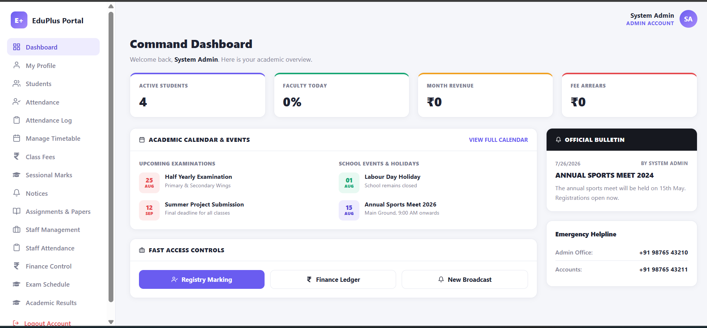
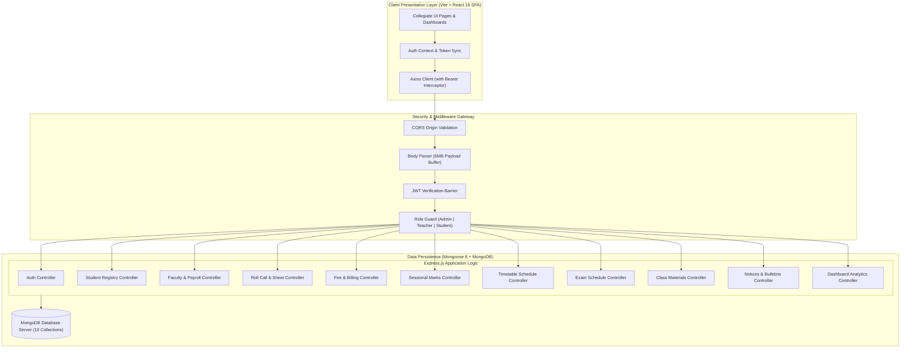

# 🏫 SchoolSync - Enterprise School Management System & ERP

<p align="center">
  
</p>

<p align="center">
  
  
  
  
  
  
  
  
</p>

---

## 📑 Table of Contents

- [1. Executive Overview](#1-executive-overview)
- [2. System Architecture](#2-system-architecture)
- [3. Entity-Relationship & Database Schema](#3-entity-relationship--database-schema)
- [4. Role-Based Access Control (RBAC)](#4-role-based-access-control-rbac)
- [5. Distinct Persona Experiences](#5-distinct-persona-experiences)
  - [5.1 Administrator (Executive Command Deck)](#51-administrator-executive-command-deck)
  - [5.2 Faculty / Teacher (Academic Cockpit)](#52-faculty--teacher-academic-cockpit)
  - [5.3 Student / Learner (Learning Center & Passport)](#53-student--learner-learning-center--passport)
- [6. Core Functional Modules](#6-core-functional-modules)
  - [6.1 Daily Roll-Call & Monthly Matrix Registry](#61-daily-roll-call--monthly-matrix-registry)
  - [6.2 Sessional Marks & Gradebook Console](#62-sessional-marks--gradebook-console)
  - [6.3 Official Student Dossier & Transcript Report](#63-official-student-dossier--transcript-report)
  - [6.4 Master Weekly Timetable Planner](#64-master-weekly-timetable-planner)
  - [6.5 Fee Collection Ledger & Student Invoices](#65-fee-collection-ledger--student-invoices)
  - [6.6 Class-Scoped Academic Materials Repository](#66-class-scoped-academic-materials-repository)
  - [6.7 Examination Datesheets & Campus Bulletins](#67-examination-datesheets--campus-bulletins)
  - [6.8 Faculty Directory & Payroll Telemetry](#68-faculty-directory--payroll-telemetry)
- [7. Complete REST API Specification](#7-complete-rest-api-specification)
- [8. Database Seeding & Mock Data Pipeline](#8-database-seeding--mock-data-pipeline)
- [9. Installation & Quick Start Guide](#9-installation--quick-start-guide)
- [10. Demo Credentials](#10-demo-credentials)
- [11. Visual Tour & Screenshots](#11-visual-tour--screenshots)
- [12. Automated Test Suite & Verification](#12-automated-test-suite--verification)
- [13. Known Limitations & Production Roadmap](#13-known-limitations--production-roadmap)
- [14. Architecture Artifacts & Documentation Index](#14-architecture-artifacts--documentation-index)
- [15. Security & Compliance Engineering](#15-security--compliance-engineering)
- [16. License & Authorship](#16-license--authorship)

---

## 1. Executive Overview

**SchoolSync** is a production-grade, enterprise School Management System (SMS) and Student Information System (SIS) built upon the modern **MERN** stack (**MongoDB, Express.js, React 18, Node.js**).

Engineered to eliminate paper friction, disjointed spreadsheets, and insecure generic templates, SchoolSync establishes a collegiate, human-crafted digital ecosystem across **Institutional Administrators**, **Academic Faculty**, and **Enrolled Students**.

### Key Architectural Pillars
- **Zero Mock Data — 100% Atomic Persistence**: Every dashboard tile, lecture period, fee status, and attendance check-in hydrates dynamically from MongoDB with strict schema validation.
- **Granular Scoped Security & Privacy**: Students are strictly quarantined to their own enrolled class, timetable, attendance history, sessional scorecards, fee dues, and study materials.
- **Collegiate Modern Design System**: Inspired by world-class platforms (**Canvas LMS, PowerSchool, Veracross, and Toddle**), SchoolSync features an Oxford Midnight navigation spine, high-contrast role badges, tactile 3-state attendance toggles, and zero generic AI-slop styling.
- **Instant Client Performance**: Optimized with Vite 5, route code-splitting, accessible WCAG 2.1 AA compliant contrast ratios, and zero Flash of Unstyled Content (FOUC).

---

## 2. System Architecture

The following diagram illustrates the multi-tier request pipeline of SchoolSync:



---

## 3. Entity-Relationship & Database Schema

The database schema is structured into 10 relational Mongoose models with compound unique indexing to guarantee data integrity:

```mermaid
erDiagram
    USER ||--o{ ATTENDANCE : "tracks"
    USER ||--o{ STAFF_ATTENDANCE : "logs"
    USER ||--o{ FEE : "incurs"
    USER ||--o{ SESSIONAL_MARK : "earns"
    USER ||--o{ MATERIAL : "shares"
    USER ||--o{ NOTICE : "publishes"
    USER ||--o{ EVENT : "schedules"

    USER {
        ObjectId _id PK
        string name
        string email UK
        string password "bcrypt hash"
        string role "admin | teacher | student"
        string rollNo "unique student identifier"
        string class "e.g. 10"
        string section "e.g. A"
        string bloodGroup
        string guardianContact
        string fatherName
        string motherName
        string teacherId "faculty identifier"
        string department
        number monthlySalary
    }

    ATTENDANCE {
        ObjectId _id PK
        ObjectId student FK
        string class
        string section
        string date "MM/DD/YYYY"
        string period "Daily or Period 1..4"
        string status "present | absent | late | holiday"
        ObjectId markedBy FK
    }

    STAFF_ATTENDANCE {
        ObjectId _id PK
        ObjectId staff FK
        string date "MM/DD/YYYY"
        string status "present | absent | late | leave"
        ObjectId markedBy FK
    }

    FEE {
        ObjectId _id PK
        ObjectId student FK
        string class
        string section
        string month
        string year
        number totalAmount
        number paidAmount
        string settlementStatus "PAID | PARTIAL | PENDING"
    }

    SESSIONAL_MARK {
        ObjectId _id PK
        ObjectId student FK
        string class
        string section
        string assessmentType "1st Sessional | 2nd Sessional | Final"
        string subject
        number marksObtained
        number maxMarks
        string remarks
    }

    TIMETABLE {
        ObjectId _id PK
        string class
        string section
        string day "Monday .. Saturday"
        string period "LEC.01 .. LEC.09"
        string subjectName
        string subjectCode
        string subjectType "Theory | Practical | Tutorial"
        string facultyName
        string department
    }

    MATERIAL {
        ObjectId _id PK
        string title
        string targetClass
        string section "All Sections or Section A..C"
        string category "STUDY MATERIAL | PAPER | HOMEWORK"
        string subject
        string link
        ObjectId uploadedBy FK
    }

    EXAM {
        ObjectId _id PK
        string examName
        string targetClass
        string examDate "DD/MM/YYYY"
        string description
    }

    NOTICE {
        ObjectId _id PK
        string title
        string content
        string category "General | Exam | Event | Urgent"
        string audience "EVERYONE | STUDENT | TEACHER"
        ObjectId publishedBy FK
    }

    EVENT {
        ObjectId _id PK
        string title
        string type "event | holiday"
        string date "YYYY-MM-DD"
        string description
    }
```



### Strategic Compound Indexes
- **Attendance Registry**: `{ student: 1, date: 1, period: 1 }` (Prevents duplicate roll-call records).
- **Staff Attendance**: `{ staff: 1, date: 1 }` (Enforces single daily attendance entry per faculty).
- **Fee Ledger**: `{ student: 1, month: 1, year: 1 }` (Guarantees one billing cycle invoice per learner).
- **Sessional Evaluation**: `{ student: 1, assessmentType: 1, subject: 1, year: 1 }` (Eliminates grade conflict).
- **Master Timetable**: `{ class: 1, section: 1, day: 1, period: 1 }` (Eliminates classroom/period double-booking).

---

## 4. Role-Based Access Control (RBAC)

Access permissions are enforced both in client route wrappers (`ProtectedRoute.jsx`) and on every backend endpoint via `authorize(...)`:

| Capability / Module | Executive Admin | Academic Faculty | Enrolled Student |
| :--- | :---: | :---: | :---: |
| **System Dashboard** | Full Institutional Overview | Faculty Cockpit | Personal Academic Hub |
| **User Profile Management** | Full CRUD | Edit Own Profile | View Own Profile |
| **Student Directory & Dossiers** | Full CRUD + Guardian Edit | Read & Filter Assigned | Hidden |
| **Daily Attendance Marking** | Mark Any Class | Mark Assigned Class | Hidden |
| **Attendance Sheet Summary** | Full Access & CSV Export | Class Access & Export | Scoped to Personal History |
| **Master Timetable Planner** | Assign, Edit & Clear Slots | View Assigned Schedule | View Class Timetable |
| **Sessional Marks Entry** | Grade & Finalize All | Grade Assigned Classes | Hidden |
| **Academic Results & Dossier** | Full Registry View | Class Registry View | View Own Scorecard Only |
| **Course Materials** | Upload & Delete Any | Upload for Class | Scoped to Enrolled Class |
| **Fee Collection & Ledger** | Mark Paid & Modify Invoices | View Only | View Own Invoices Only |
| **Finance Balance Sheet** | Revenue vs. Payroll Expenses | Hidden | Hidden |
| **Faculty Directory & Salaries**| Full CRUD & Payroll Config | Hidden | Hidden |
| **Staff Attendance Register** | Mark & Audit Faculty Attendance| Hidden | Hidden |
| **Exam Schedule Planner** | Schedule & Delete Exams | View Schedule | Scoped to Enrolled Class |
| **Notice Bulletin Board** | Broadcast to Any Audience | Broadcast to Students | View Scoped Bulletins |

---

## 5. Distinct Persona Experiences

### 5.1 Administrator (Executive Command Deck)
- **Financial Health Bar**: Live tracking of collected term fees vs. outstanding arrears with an interactive progress meter.
- **Institutional Telemetry**: Live student count, faculty on duty, daily attendance percentage, and operational expense tracking.
- **Fast Dispatch Hub**: One-click quick links to Enroll Student, Mark Attendance, Manage Timetable, Post Bulletins, and Schedule Exams.

### 5.2 Faculty / Teacher (Academic Cockpit)
- **Teaching Flow**: Real-time display of today's assigned lectures color-coded by discipline (Math blue, Physics sky, Chemistry violet, English amber, Computer Science emerald).
- **Pending Roll-Call Alert**: Visual reminder notifying faculty of uncompleted daily class attendance.
- **Class Load Telemetry**: Summary of assigned classes and active student count.

### 5.3 Student / Learner (Learning Center & Passport)
- **Attendance Compliance Meter**: Real-time attendance rate with compliance tag (`COMPLIANT ≥ 75%` or `WARNING`).
- **Academic Scorecard Average**: Cumulative percentage calculated across all sessional exams.
- **Fee Settlement Pill**: Instant badge (`PAID`, `PARTIAL`, or `PENDING`) with dollar balance due.
- **My Classes Today**: Chronological timeline of daily periods with subject codes, room details, and professor names.

---

## 6. Core Functional Modules

### 6.1 Daily Roll-Call & Monthly Matrix Registry
- **Instant Roll-Call**: Select class, section, date, and period.
- **Tactile Segmented Toggles**: Clickable state pills (`[ ✓ Present ]`, `[ ✕ Absent ]`, `[ ⏱ Late ]`) with live status tallies.
- **Monthly Matrix (`AttendanceLog.jsx`)**: Full calendar matrix with symbol indicators (`✓`, `✕`, `L`), print preview, and CSV export.

### 6.2 Sessional Marks & Gradebook Console
- **Bulk Grade Entry**: Enter marks obtained, max marks, and custom teacher remarks.
- **Automated Pass/Fail Benchmarking**: Automated pass/fail calculations based on institutional 33% passing standards.

### 6.3 Official Student Dossier & Transcript Report
- **Student Profile Dossier**: Avatar badge, student name, roll number, academic session, and emergency contact details.
- **Attendance Audit**: Breakdown of total instructional sessions, verified present days, unexcused absences, and compliance rate.
- **Sessional Scorecard**: Progress tracks for each subject with color-coded score percentages and pass/fail indicators.
- **Print Optimization**: Clean print layout for generating official transcripts.

### 6.4 Master Weekly Timetable Planner
- **Full 6-Day Schedule Grid**: Covers Monday through Saturday across 9 structured periods.
- **Modal Assignment Interface**: Quick assignment modal for subject code, faculty, subject type (Theory/Practical), and department.
- **Slot Conflict Prevention**: Database indexes prevent duplicate slot allocations.

### 6.5 Fee Collection Ledger & Student Invoices
- **Institutional Ledger**: Track fees by class, section, month, and year.
- **One-Click Payment Settlement**: Fast status toggle to record student fee clearances.
- **Student Invoice View (`MyFees.jsx`)**: Personal billing statement with printable fee receipt.

### 6.6 Class-Scoped Academic Materials Repository
- **Categorized Library**: Segregated into `STUDY MATERIAL`, `PAPER`, and `HOMEWORK`.
- **Enrolled Class Scoping**: Students only see verified materials uploaded for their specific grade level.

### 6.7 Examination Datesheets & Campus Bulletins
- **Countdown Datesheets**: Displays upcoming exams with days-remaining countdowns (`In 4 days`).
- **Audience-Targeted Bulletins**: Filter bulletins by audience (`EVERYONE`, `TEACHER`, `STUDENT`) and category (General, Exam, Event, Urgent).

### 6.8 Faculty Directory & Payroll Telemetry
- **Faculty Records**: Centralized roster with department, designation, employee ID, and contact details.
- **Payroll Reconciliation**: Automated payroll tracking feeding into institutional expense reports.

---

## 7. Complete REST API Specification

All secured endpoints require the `Authorization: Bearer <token>` HTTP header.

### 🔐 Authentication (`/api/auth`)
| Method | Endpoint | Access | Description |
| :--- | :--- | :--- | :--- |
| `POST` | `/api/auth/register` | Public / Admin | Register new user account |
| `POST` | `/api/auth/login` | Public | Authenticate via email or roll number + password |
| `GET` | `/api/auth/me` | Protected | Fetch current user session profile |
| `PUT` | `/api/auth/profile` | Protected | Update profile details and base64 avatar image |

### 👨‍🎓 Students (`/api/students`)
| Method | Endpoint | Access | Description |
| :--- | :--- | :--- | :--- |
| `GET` | `/api/students` | Admin, Teacher | Retrieve all registered student records |
| `GET` | `/api/students/:id` | Protected | Fetch single student dossier by MongoDB ID |
| `POST` | `/api/students` | Admin | Enroll new student |
| `PUT` | `/api/students/:id` | Admin, Teacher | Update student demographic / academic info |
| `PUT` | `/api/students/:id/guardian` | Admin, Teacher | Update student guardian emergency contacts |
| `DELETE` | `/api/students/:id` | Admin | Delete student record |

### 👨‍🏫 Faculty & Staff (`/api/staff`)
| Method | Endpoint | Access | Description |
| :--- | :--- | :--- | :--- |
| `GET` | `/api/staff` | Admin | Retrieve all faculty and staff profiles |
| `POST` | `/api/staff` | Admin | Add new faculty member with salary details |
| `PUT` | `/api/staff/:id` | Admin | Update faculty credentials and salary |
| `DELETE` | `/api/staff/:id` | Admin | Remove faculty member |

### 📅 Attendance Tracking (`/api/attendance` & `/api/staff-attendance`)
| Method | Endpoint | Access | Description |
| :--- | :--- | :--- | :--- |
| `GET` | `/api/attendance/roll` | Admin, Teacher | Load class roll list for date & period |
| `POST` | `/api/attendance/save` | Admin, Teacher | Bulk save/upsert daily roll-call entries |
| `GET` | `/api/attendance/summary` | Protected | Monthly attendance matrix (scoped for students) |
| `GET` | `/api/attendance/student/:id`| Protected | Cumulative student attendance report |
| `GET` | `/api/staff-attendance` | Admin | Load staff daily attendance register |
| `POST` | `/api/staff-attendance/save` | Admin | Bulk save/upsert staff attendance |

### 💰 Fees & Billing (`/api/fees`)
| Method | Endpoint | Access | Description |
| :--- | :--- | :--- | :--- |
| `GET` | `/api/fees` | Admin, Teacher | Class fee collection ledger |
| `PUT` | `/api/fees/:id` | Admin | Update fee payment and settlement status |
| `GET` | `/api/fees/my-fees` | Student | Personal fee dues, payments, and receipts |
| `GET` | `/api/fees/student/:id` | Protected | Retrieve full fee history for student |

### 📝 Sessional Marks & Results (`/api/marks`)
| Method | Endpoint | Access | Description |
| :--- | :--- | :--- | :--- |
| `GET` | `/api/marks` | Admin, Teacher | Sessional marks entry grid by subject |
| `POST` | `/api/marks/save` | Admin, Teacher | Bulk save and finalize student grades |
| `GET` | `/api/marks/student/:id` | Protected | Complete academic scorecard for student |

### 📖 Master Timetable (`/api/timetable`)
| Method | Endpoint | Access | Description |
| :--- | :--- | :--- | :--- |
| `GET` | `/api/timetable` | Protected | Retrieve 6-day lecture schedule for class |
| `POST` | `/api/timetable/assign` | Admin | Assign or update a lecture slot |
| `DELETE` | `/api/timetable/:id` | Admin | Remove a lecture slot |

### 📚 Materials, Exams, Bulletins & Analytics
| Method | Endpoint | Access | Description |
| :--- | :--- | :--- | :--- |
| `GET` | `/api/materials` | Protected | Fetch course materials (scoped for students) |
| `POST` | `/api/materials` | Admin, Teacher | Upload new study material / assignment |
| `DELETE`| `/api/materials/:id` | Admin, Teacher | Remove study material |
| `GET` | `/api/exams` | Protected | Scheduled examinations (scoped for students) |
| `POST` | `/api/exams` | Admin | Add new examination datesheet |
| `DELETE`| `/api/exams/:id` | Admin | Remove examination datesheet |
| `GET` | `/api/notices` | Protected | Official bulletins (filtered by audience) |
| `POST` | `/api/notices` | Admin, Teacher | Broadcast official notice |
| `DELETE`| `/api/notices/:id` | Admin | Remove notice |
| `GET` | `/api/dashboard/stats` | Protected | Persona-scoped live dashboard metrics |

---

## 8. Database Seeding & Mock Data Pipeline

SchoolSync includes an automated seeding pipeline in `server/utils/seed.js`. Executing `npm run seed` completely purges and re-populates the database with synchronized relational data across all 10 collections:

```bash
cd server
npm run seed
```

### Seeding Payload Summary
- **1 Administrator**: Root administrative credentials.
- **5 Academic Faculty Members**: Department heads across Mathematics, Physics, English, Computer Science, and Chemistry.
- **11 Enrolled Students**: Spread across Class 10 (A & B) and Class 3.
- **187 Attendance Records**: Realistic 20-day attendance history per student.
- **35 Staff Attendance Logs**: Multi-day faculty attendance records.
- **33 Fee Invoices**: Realistic spread of `PAID`, `PARTIAL`, and `PENDING` states.
- **102 Sessional Mark Entries**: 1st & 2nd Sessional grades with teacher remarks.
- **126 Timetable Slots**: 6 days × 8 periods per class.
- **14 Course Materials, 4 Exams, 5 Notices, and 3 Campus Events**.

---

## 9. Installation & Quick Start Guide

### Prerequisites
- **Node.js**: `v18.0.0` or higher (`v20+` recommended)
- **npm**: `v9.0.0` or higher
- **MongoDB**: Local Community Server running at `mongodb://127.0.0.1:27017` or a MongoDB Atlas URI

---

### Step 1: Clone the Repository
```bash
git clone https://github.com/Swarajbabu/SchoolSync-School-Management-System.git
cd SchoolSync-School-Management-System
```

---

### Step 2: Configure & Start Backend Server
```bash
cd server

# Install backend packages
npm install

# Setup environment variables
cp .env.example .env
```

Verify `server/.env`:
```env
PORT=5000
MONGO_URI=mongodb://127.0.0.1:27017/schoolsync
JWT_SECRET=schoolsync_secure_session_key_2026
JWT_EXPIRES_IN=7d
CLIENT_URL=http://localhost:5173
```

Run database seeder:
```bash
npm run seed
```

Start backend development server:
```bash
npm run dev
# or
npm start
```
*Backend API runs at: `http://localhost:5000`*

---

### Step 3: Configure & Start Frontend Client
Open a second terminal window:
```bash
cd client

# Install frontend packages
npm install

# Setup environment variables
cp .env.example .env
```

Verify `client/.env`:
```env
VITE_API_URL=http://localhost:5000/api
```

Start Vite frontend server:
```bash
npm run dev
```
*Frontend application runs at: `http://localhost:5173`*

---

## 10. Demo Credentials

Use these pre-seeded accounts to explore each persona:

### 👨‍💼 System Administrator
- **Portal Tab**: Staff / Admin
- **Email**: `admin@school.com`
- **Password**: `admin123`
- **Scope**: Full system access across all 15+ modules, finance, faculty payroll, and timetable planner.

### 👨‍🏫 Academic Faculty / Teacher
- **Portal Tab**: Staff / Admin
- **Email**: `charu.s@schoolsync.edu`
- **Password**: `teacher123`
- **Scope**: Class roll call, marks grading, study material uploads, student transcripts, and bulletins.

### 👨‍🎓 Enrolled Student
- **Portal Tab**: Student
- **Roll Number**: `4` *(or Email: `student@schoolsync.edu`)*
- **Password**: `student123`
- **Scope**: Personal academic hub, sessional transcript scorecard, attendance history, homework, and fee receipts.

---

## 11. Visual Tour & Screenshots

| Module View | Preview | Key Features |
| :--- | :--- | :--- |
| **Authentication Portal** | [Preview](screenshots/login-signup.png) | Role toggle tab, input validation, and password visibility |
| **Executive Dashboard** | [Preview](screenshots/dashboard.png) | Financial collection progress, student/staff KPI tiles |
| **Students Registry** | [Preview](screenshots/students.png) | Search by name/roll, class filter pills, avatar crests |
| **Admin Control Panel** | [Preview](screenshots/admin.png) | Institutional settings and system governance |
| **Daily Roll Call** | [Preview](screenshots/class-entry.png) | Interactive 3-state buttons (`Present`, `Absent`, `Late`) |
| **Attendance Matrix** | [Preview](screenshots/attendance-log.png) | Month calendar matrix with CSV export and print preview |
| **Faculty Roster** | [Preview](screenshots/staff-management.png) | Department, designation, and salary configuration |
| **Staff Attendance** | [Preview](screenshots/staff-attendance.png) | Daily faculty check-in registry |
| **Fee Collection Ledger**| [Preview](screenshots/fees.png) | Instant settlement status toggles and balance calculation |
| **Finance Balance Sheet**| [Preview](screenshots/finance.png) | Real-time collected revenue vs. faculty salary expenses |
| **Master Timetable** | [Preview](screenshots/timetable.png) | Weekly 6-day lecture allocation matrix |
| **Sessional Marks Entry**| [Preview](screenshots/session-marks.png) | Bulk marks entry with automated pass/fail computation |
| **Academic Scorecard** | [Preview](screenshots/results.png) | Printable transcript with attendance metrics and marks |
| **Course Materials** | [Preview](screenshots/assignment.png) | Class-scoped repository for notes, papers, and homework |
| **Exam Datesheets** | [Preview](screenshots/exam-schedule.png) | Session examination calendar with countdown timers |
| **Notice Bulletin Board**| [Preview](screenshots/notice-board.png) | Segmented bulletins by audience (`EVERYONE`, `TEACHER`, `STUDENT`) |

---

## 12. Automated Test Suite & Verification

SchoolSync includes a native, automated end-to-end integration test suite built with Node.js's native test runner (`node:test` and `node:assert`).

### Running the Test Suite
```bash
cd server
npm test
```
*Or directly:*
```bash
node --test tests/api.test.js
```

### Test Coverage Summary
- **System Health & Infrastructure**: Health checks, graceful error handling, 404 route handling.
- **Authentication & JWT Lifecycles**: Token issuance, password verification, invalid password rejections, non-existent identity guards.
- **Role-Based Access Control (RBAC)**: Endpoint route guards ensuring Admin-only routes strictly reject Student tokens with `403 Forbidden`.
- **Dynamic Database Class/Section Discovery**: Verifies that `/api/students/classes-sections` aggregates live student classes and sections accurately without static hardcoding.
- **Fee Ledger & Settlement Mathematics**: Mathematical verification of `PAID`, `PARTIAL`, and `PENDING` states, zero-balance enforcement, and unauthorized student modification guards.
- **Attendance Registry**: Roll-call roster extraction, bulk attendance saving, and missing-parameter boundary rejection.
- **Timetable Scheduling**: Verification of 6-day weekly timetable grid queries.
- **Official Bulletins & Notices**: Announcement authoring and role-based deletion barriers.

*Live execution logs are archived at [docs/test-results.log](docs/test-results.log) (22/22 tests passing).*

---

## 13. Known Limitations & Production Roadmap

While SchoolSync provides a comprehensive ERP workflow for K-12 and collegiate institutions, the following architectural boundaries are tracked for future releases:

1. **Payment Gateway Integration**: Current fee ledger operations support cash, cheque, and bank receipt reconciliation. Direct integration with payment gateways (Stripe / Razorpay webhooks) is planned for automated ledger settlement.
2. **Push Notifications & SMS Gateways**: Notices and attendance alerts currently trigger in-app updates; automated SMS/WhatsApp alerts for student absence require Twilio / MSG91 webhook configuration.
3. **Blob Storage for Heavy Course Materials**: Course materials and homework links currently store direct URLs and metadata; integration with AWS S3 / Cloudinary for direct multi-gigabyte video lectures and PDFs is scheduled.
4. **Offline Mobile Synchronization**: The web client is fully responsive across desktop, tablet, and mobile; native offline PWA service-worker synchronization for remote attendance marking is in development.

---

## 14. Architecture Artifacts & Documentation Index

- 📄 **API Specification (OpenAPI 3.0)**: [docs/openapi.yaml](docs/openapi.yaml)
- 📊 **Entity-Relationship & Schema Diagram**: [docs/schema-and-er-diagram.md](docs/schema-and-er-diagram.md)
- 🧪 **Automated Test Execution Evidence**: [docs/test-results.log](docs/test-results.log)
- 📑 **Technical Design Whitepaper (Monochrome PDF)**: [docs/technical-report.pdf](docs/technical-report.pdf)
- 📝 **Technical Design Whitepaper (Markdown)**: [docs/technical-report.md](docs/technical-report.md)

---

## 15. Security & Compliance Engineering

1. **Bcrypt Password Hashing**: Passwords are salted and encrypted with 10 rounds of `bcryptjs` hashing.
2. **Stateless JWT Authorization**: Bearer tokens carry verified claims with automatic expiry rejection (`401 Unauthorized`).
3. **Role-Based Middlewares**: Strict server-side route guards reject unauthorized role calls with `403 Forbidden`.
4. **CORS Governance**: Configured to restrict cross-origin requests strictly to authorized client domains.
5. **NoSQL Injection Prevention**: Structured Mongoose models sanitize input queries and enforce strict types.
6. **Payload Guard**: Express JSON body size restricted to `6MB` to support student profile photos safely without DoS risk.

---

## 16. License & Authorship

Distributed under the **MIT License**. See `LICENSE` for details.

### 👨‍💻 Project Author & Maintainer
**Vecha Laxmi Swaraj Babu**
- GitHub: [@Swarajbabu](https://github.com/Swarajbabu)
- Repository: [SchoolSync-School-Management-System](https://github.com/Swarajbabu/SchoolSync-School-Management-System)

---

<p align="center">
  <b>⭐ Star this repository if you find it helpful for your learning, institution, or project! ⭐</b>
</p>
