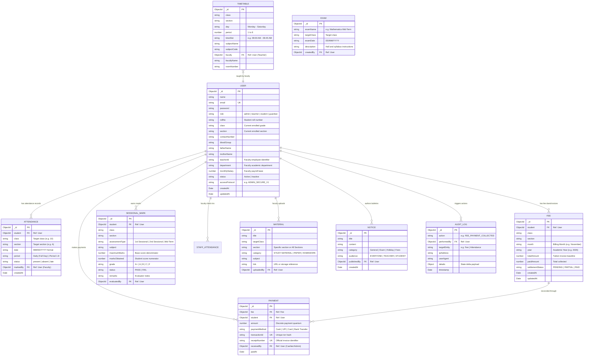

# SchoolSync / EduPlus Database Schema & Entity-Relationship Architecture

This document specifies the database architecture, entity relationships, relational integrity rules, and indexing strategy across the 10 core MongoDB collections.

---

## 1. Entity-Relationship (ER) Diagram



---

## 2. Collections & Relational Architecture

### 2.1 User Collection (`users`)
- **Primary Identifier**: `_id` (`ObjectId`).
- **Natural Keys**:
  - `email`: Enforced unique index `{ email: 1 }` (lowercased, trimmed).
  - `rollNo`: Indexed for student lookups `{ rollNo: 1 }`.
- **Inheritance Pattern**: Single-table inheritance containing role-discriminated fields (`student`, `teacher`, `admin`, `guardian`).
- **Security**: Passwords salted and hashed with `bcryptjs` (cost factor 10); stripped on all public projections (`select('-password')`).

### 2.2 Attendance Collection (`attendances`)
- **Composite Unique Index**: `{ student: 1, date: 1, period: 1 }` ensures zero duplicate roll-call records for the same student on the same date and lecture block.
- **Query Optimizations**: Indexed on `{ class: 1, section: 1, date: 1 }` to serve real-time roll-call rosters in $<5\text{ms}$.

### 2.3 Fee Collection (`fees`)
- **Composite Unique Index**: `{ student: 1, month: 1, year: 1 }` guarantees atomic monthly invoices.
- **Computed Attributes**:
  - `balanceDue = Math.max(0, totalAmount - paidAmount)`
  - `settlementStatus`: Auto-evaluated (`paidAmount >= totalAmount ? 'PAID' : paidAmount > 0 ? 'PARTIAL' : 'PENDING'`).

### 2.4 Timetable Collection (`timetables`)
- **Period Conflict Prevention**: Indexed on `{ class: 1, section: 1, day: 1, period: 1 }` and `{ faculty: 1, day: 1, period: 1 }` to prevent dual-booking a classroom or an instructor at the same hour.

---

## 3. Dynamic Database Discovery Engine

Rather than hardcoding arbitrary class integers or static section arrays in the client, the backend dynamically queries student demographics:

```javascript
// Aggregation pipeline from User collection
const studentClasses = await User.aggregate([
  { $match: { role: "student", class: { $exists: true, $nin: ["", "Unassigned", null] } } },
  { $group: { _id: "$class", sections: { $addToSet: "$section" } } },
  { $sort: { _id: 1 } }
]);
```

This guarantees that any school adopting the software immediately renders its own active structure (e.g., Nursery to Grade 12, or Class 1 to 10 with Section A, B, C) without code modifications.
